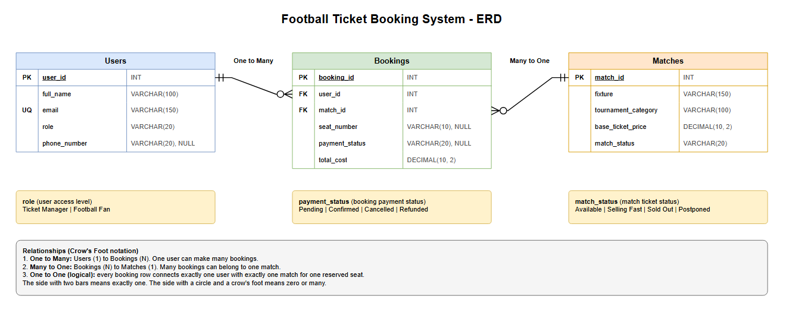

# Football Ticket Booking System

Database design and SQL queries for a football ticket booking system. Fans can book tickets for tournament matches, and every booking keeps the seat, the payment status and the total cost.

The database is made with PostgreSQL.

## ERD

**ERD Link:** [Open the ERD in Draw.io](https://viewer.diagrams.net/?tags=%7B%7D&lightbox=1&highlight=0000ff&edit=_blank&layers=1&nav=1&title=ERD.drawio#Uhttps%3A%2F%2Fraw.githubusercontent.com%2Febrahim2355%2Ffootball-ticket-booking-system%2Fmain%2FERD.drawio)

The diagram file is also in this repository as `ERD.drawio`.



Relationships in the ERD:

- **One to Many:** one user can make many bookings (`Users` to `Bookings`).
- **Many to One:** many bookings can belong to one match (`Bookings` to `Matches`).
- **One to One (logical):** every booking row connects exactly one user with exactly one match for one reserved seat.

## Tables

### Users

| Field | Type | Details |
| --- | --- | --- |
| user_id | INT | Primary key |
| full_name | VARCHAR(100) | Required |
| email | VARCHAR(150) | Required, unique |
| role | VARCHAR(20) | `Ticket Manager` or `Football Fan` |
| phone_number | VARCHAR(20) | Can be NULL |

### Matches

| Field | Type | Details |
| --- | --- | --- |
| match_id | INT | Primary key |
| fixture | VARCHAR(150) | Required |
| tournament_category | VARCHAR(100) | Required |
| base_ticket_price | DECIMAL(10, 2) | Required, cannot be negative |
| match_status | VARCHAR(20) | `Available`, `Selling Fast`, `Sold Out` or `Postponed` |

### Bookings

| Field | Type | Details |
| --- | --- | --- |
| booking_id | INT | Primary key |
| user_id | INT | Foreign key to `Users(user_id)` |
| match_id | INT | Foreign key to `Matches(match_id)` |
| seat_number | VARCHAR(10) | Can be NULL |
| payment_status | VARCHAR(20) | `Pending`, `Confirmed`, `Cancelled` or `Refunded`, can be NULL |
| total_cost | DECIMAL(10, 2) | Required, cannot be negative |

## Queries

All the queries are in `QUERY.sql`, after the table creation and the sample data.

| No | Query | Concepts |
| --- | --- | --- |
| 1 | Available matches of the Champions League | `WHERE`, `AND` |
| 2 | Users whose name starts with 'Tanvir' or contains 'Haque' | `ILIKE` |
| 3 | Bookings with missing payment status, shown as 'Action Required' | `IS NULL`, `COALESCE` |
| 4 | Booking details with the user name and the match fixture | `INNER JOIN` |
| 5 | All users with their booking ids, including users with no booking | `LEFT JOIN` |
| 6 | Bookings that cost more than the average booking cost | Subquery, `AVG` |
| 7 | Top 2 most expensive matches after skipping the highest one | `ORDER BY`, `LIMIT`, `OFFSET` |

## How to Run

1. Create a database in PostgreSQL.

```sql
CREATE DATABASE football_ticket_booking;
```

2. Run the file with `psql`.

```bash
psql -U postgres -d football_ticket_booking -f QUERY.sql
```

The file can also be opened and run in pgAdmin or any other PostgreSQL tool. It drops the old tables first, so it can be run again and again.
